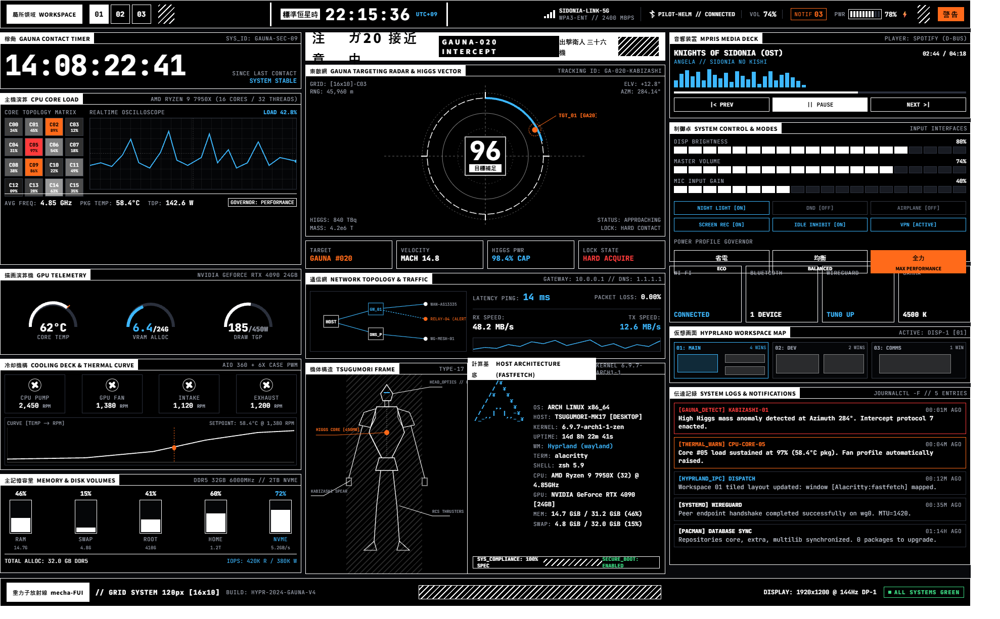

# mecha-FUI

> **Status: pre-alpha, design phase.** The mockup exists, the code does not yet. See [ROADMAP.md](ROADMAP.md) for progress.

A mecha-style FUI (fantasy user interface) HUD shell for [Hyprland](https://hyprland.org/), built with [Quickshell](https://quickshell.org/) (QML). Dense live telemetry, hazard stripes, kanji-labeled panels, and an industrial brutalist command-bridge look, visually inspired by *Knights of Sidonia*.



*Design mockup only. This is a reference render, not running software, and the v1 layout differs from it (the center column becomes an empty stage, see [ROADMAP.md](ROADMAP.md)). A real screenshot replaces it at v1.0.*

## Planned features

- **Top bar:** workspaces, active client, network, Bluetooth, volume, notifications, battery, clock
- **Telemetry panels:** per-core CPU, memory, disks, GPU, fans and fan curve, network sparkline
- **Custom-drawn widgets:** CPU oscilloscope, heat grid, arc dials
- **Center stage:** transparent by default so your wallpaper shows; L2 detail views (battery, CPU, net, system info, notification history) open there
- **Control panel:** brightness, volume, mic, toggles, power profile, workspace map
- **Media deck:** MPRIS player controls
- **Notification feed:** real notification daemon, styled as incoming transmissions
- **Alert escalation:** HUD flips to a higher alert level when CPU, temps, or battery cross thresholds
- **Configurable:** nothing hardware-specific is hardcoded; everything lives in `config.json`

## Requirements

Tested versions will be pinned here once v1.0 ships.

- Hyprland
- Quickshell
- [JetBrains Mono](https://www.jetbrains.com/lp/mono/) (OFL)
- A CJK font for the kanji labels: Noto Sans Mono CJK JP (preferred) or Noto Sans JP (both OFL). Without one, labels like 警戒 render as empty boxes. Fonts are not bundled.
- Optional: `nvidia-smi` for the NVIDIA GPU module

## Install

Not available yet. An install script will land with v1.0.

## Configuration

Copy `config.example.json` to `config.json` and adjust. It will cover:

- network interface and disk mount points
- GPU backend (or disabled)
- hwmon sensor and fan mapping
- alert thresholds
- optional effects (scanlines, glitch)
- wallpaper dim and panel opacity (your wallpaper is set separately, for example with hyprpaper)

## Project structure (planned)

```
shell.qml          entry point
components/        reusable UI (Panel, bars, gauges, oscilloscope)
services/          data sources (cpu, mem, gpu, fans, net, ...)
config.json        user config
design/            mockup, tokens, references
```

## Design

- Palette: near-black background, white borders, electric blue for live data, orange as the focal color, red for alerts, green for OK states
- 1px borders, no rounded corners, monospace type
- Strict grid (120px cell on a 1920x1200 reference, scaled to your screen), three type sizes plus the clock
- Exact values: [design/tokens.json](design/tokens.json). Full rules: the M0 section of [ROADMAP.md](ROADMAP.md)
- Reference search terms: *FUI HUD*, *tactical HUD*, *Evangelion UI*

## Roadmap

See [ROADMAP.md](ROADMAP.md).

## Credits and disclaimer

Visual inspiration from *Knights of Sidonia* by Tsutomu Nihei. This is an unofficial fan-inspired project and is not affiliated with or endorsed by the author or the studios involved. No official assets are used.

## License

[MIT](LICENSE)
