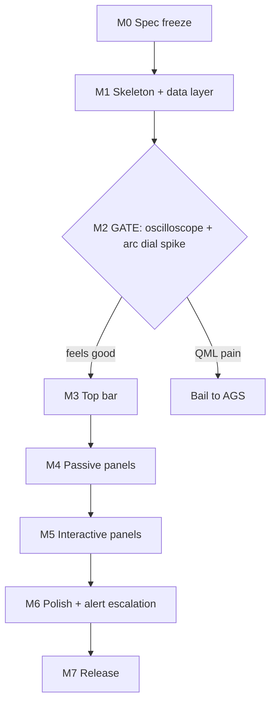

# ROADMAP

Project name: **mecha-FUI**

Goal: a mecha-style FUI HUD shell for Hyprland (visually inspired by Knights of Sidonia), built in Quickshell (QML), published on GitHub and shown on r/unixporn.

## Rules

- **Definition of done for every milestone:** runs on a real machine, survives a reboot, committed and tagged.
- **Hardware is never hardcoded.** Everything machine-specific lives in `config.json`. NVIDIA-only features are optional and degrade gracefully.
- **Scope is frozen at M0.** New ideas go to the v2 list at the bottom. No exceptions.
- A mockup that only works in a screenshot does not count as progress.

---

## M0: Spec freeze

- [x] Export the Stitch HTML and a full-res screenshot into `/design` (`design/mockup.html`, `design/mockup.png`)
- [x] Write design tokens: colors, font, 1px borders, spacing grid (`design/tokens.json`)
- [x] Freeze the v1 feature list (in/out). See "v1 scope" below. Frozen 2026-11-05
- [x] Pick the project name: mecha-FUI
- [x] Pick a license: MIT (`LICENSE`, copyright holder is a placeholder, confirm the name before publishing)
- [ ] Create the repo, first commit is this roadmap and the README
- [x] Draw the wireframe (blocks on the grid, panel names only) and approve it as the layout spec (v3 below)

### v1 scope (frozen)

**IN**
- Top bar: workspaces, active client, net, Bluetooth, volume, notification count, battery, clock, always visible
- Left column, look-only: uptime timer, CPU matrix (heat grid + oscilloscope), cooling deck (fan RPM and temps), memory and disks, GPU telemetry (optional module, built last)
- Center: thin alert strip plus an empty transparent **stage** (wallpaper shows through). L2 drill-down views open here
- Right column, keybind overlay: media deck, control panel (brightness, volume, mic sliders; toggles for night light, DND, idle inhibit, airplane; power profile), workspace map, notification feed (real daemon)
- L2 views: battery detail, per-core detail with top processes, net (ping, up/down sparkline, connections), system info (fastfetch-style), notification history
- Systems: alert escalation, eco/full power mode, `config.json`, glass panel fill, status footer (alert level, power mode, resolution)

**OUT (v2 list)**
- Radar ring and target/velocity/lock tiles (fake data, duplicated CPU load)
- Mech silhouette (needs original art)
- Fan curve chart (implies fan control, and many laptops do not expose fan RPM)
- Net node graph (no real data behind it)
- Quick status tiles (duplicate the top bar)
- Screen-rec and VPN toggles (each needs its own external tool)
- CRT scanlines and glitch effects
- L3 drill-down level (L2 is the maximum depth)

**Rule from here:** a new idea goes to the v2 list, and only gets built after v1.0 ships.

### Design rules (M0 tokens)

Reference material: the Stitch mockup is the **content** spec (which panels, what data). The Sidonia monitor design sheet is the **style** reference (grid, color discipline, hierarchy). Take the rules from it, not the layout.

**Grid**
- Reference screen is 1920x1200 (16:10). Base cell is **120px**, giving a 16 x 10 grid. Half-cell is **60px** for small tiles.
- Cell size is computed as screen width / 16, so the layout scales to other resolutions.
- Every panel edge snaps to a grid line. No free-floating pixel positions.
- Gaps between panels are identical everywhere: **8px**, no exceptions. Because of the shared gap, the top bar and footer are 56px and the columns are 596 / 712 / 596px (check: 56+8+1072+8+56 = 1200, 596+8+712+8+596 = 1920).
- Panels are 1 cell minimum, tiles are 0.5 cell minimum.

**Color**
- White is the default for **panel borders**, header tabs, active states and huge numerals. Inner dividers and empty segments use dim `#2B303C`. (An earlier draft proposed dim panel borders. The approved mockup uses white ones and it works, so white wins.)
- Electric blue is for live data only.
- Orange is for one focal point per panel, or a warning level on a scale (heat cells, notification severity).
- Red is for alerts only. Green is for OK states only, used rarely.
- No other colors. No gradients, no shadows.

**Wallpaper and transparency**
- The wallpaper is the user's own layer (hyprpaper, swww). The shell never draws it.
- Panels use `panel-glass` (black at about 80% alpha) so a wallpaper shows faintly through while 11px labels stay readable. Solid `panel` is the fallback when no wallpaper is used.
- The **center stage is fully transparent**. The planet is the focal point, and L2 views open on top of it. That is the "pilot seat" look.
- Hatched filler cells are transparent.
- Recommended wallpaper: dark space with a planet limb in a lower corner, darkened. Avoid bright full-disk images behind small text.
- No blur in v1 (it softens the hard-edged look). Revisit later if wanted.

**Type hierarchy (three sizes, plus the clock)**
- HUGE (56px): key numerals and kanji (the "96", "704" style). One per region.
- NORMAL (14px): readable values and titles.
- LABEL (11px): small uppercase labels in **light gray** `#9AA0AD`, never below 11px absolute.
- CLOCK (32px): top bar clock only. This is the one exception to the three-size rule.
- One monospace font everywhere: JetBrains Mono, with Noto Sans Mono CJK JP for kanji. Values right-aligned and bright, labels dim.
- Exact values live in `design/tokens.json`.

**Lines and shape**
- 1px hairline borders only. Single line weight across the whole HUD.
- Zero border radius.
- Panel header style is the same for every panel (kanji tag + English title).

**Content mix**
- Every region needs at least one graphic (ring, waveform, bar matrix, icon grid, diagram), not only `label: value` rows.
- Text-only panels are the exception, not the default.

**Empty space**
- Leftover grid cells become **hatched filler cells**, not blank gaps.
- Hatched fill is toggleable in `config.json`.

**Alert escalation**
- At higher alert levels the focal color shifts (orange to red) and hazard stripes intensify. Layout never changes.

Note: pixel values above are starting points. Tune them in M1 against a real screen.

### Mockup known issues (do NOT copy these into the build)

`design/mockup.html` is a **look** reference, not a layout spec. Known defects:

- The alert header text overflows its strip and the "三十六機" tag is clipped.
- The quick status tiles overlap the power profile row and are about twice the intended height.
- Dead space under the CPU oscilloscope (and the last heat-grid row is cut off) and below the fastfetch specs. These belong to hatched filler or real content.
- The "HOST ARCHITECTURE" label overflows into the kernel line.
- Net topology labels are tiny and truncated.
- Many elements use font sizes of 8-10px (heat cell and toggle labels, plus inline styles), which breaks the 11px minimum. It also uses about a dozen different sizes against the three-size rule. The build follows the tokens, not the mockup.
- The exported screenshot is 1978x1225, so it is not pixel-exact to the 1920x1200 reference.

### Layout spec v3 (approved, supersedes v2)

Sizes are columns x rows. Reference grid is 16 x 10 cells. Top bar and footer are half-rows, so the main area is 9 rows.

| Zone | Panel | Size | Widget type |
|---|---|---|---|
| Top | Top bar (workspaces, active client, status cluster, clock) | 16 x 0.5 | mixed |
| Left (cols 0-4), look-only | Uptime timer | 5 x 1 | huge numerals |
| | CPU matrix | 5 x 3.5 | heat grid + oscilloscope |
| | GPU telemetry (optional module) | 5 x 1.5 | arc dials |
| | Cooling deck | 5 x 1.5 | fan glyphs + temps |
| | Memory + disks | 5 x 1.5 | vertical bars |
| Center (cols 5-10) | Alert strip | 6 x 0.5 | text strip |
| | Stage (transparent, hosts L2 views) | 6 x 8.5 | empty by default |
| Right (cols 11-15), overlay | Media deck | 5 x 1.5 | controls + visualizer |
| | Control panel | 5 x 2.5 | sliders, toggles, power profile |
| | Workspace map | 5 x 1 | mini map |
| | Notification feed | 5 x 4 | list (real notification daemon) |
| Bottom | Status footer | 16 x 0.5 | text strip |

Row checks: left 1 + 3.5 + 1.5 + 1.5 + 1.5 = 9. Center 0.5 + 8.5 = 9. Right 1.5 + 2.5 + 1 + 4 = 9.

**Interactive zone:** L1 controls live in the right column only, which is a keybind-toggled overlay (confirmed), because a background HUD is unreachable under fullscreen windows. The left column is look-only. L2 views open in the center stage, triggered by a keybind, a panel header click, or a top-bar module click (the top bar is always visible). Battery lives only in the top bar (no duplicate panel); its detail is an L2 view.

**Resting state:** top bar, left column and the wallpaper. Overlays and L2 views appear on demand. Take release screenshots with an overlay and an L2 view open.

### Widget vocabulary (one job per type)

| Widget type | Used for |
|---|---|
| Heat grid of cells | per-item state (CPU cores) |
| Vertical bars | capacity and levels (memory, disks) |
| Horizontal segmented bar | progress and charge (battery, volume) |
| Waveform | change over time (CPU scope, net) |
| Arc dial | one bounded value (GPU temp, power) |
| Huge numerals | one headline number (uptime) |

Never reuse a widget type for a different job.

### Interaction levels

- **L0 Glance:** always visible, no input needed.
- **L1 Direct controls:** click, drag, toggle in the right-column overlay (sliders, toggles, media buttons, workspace switch).
- **L2 Drill-down:** click a panel header or a top-bar module to open a detail view in the center stage. Views: battery (cell voltages, health, charge rate, cycle count), CPU (per-core detail and top processes), net (ping, up/down sparkline, connections), system info (fastfetch-style), notification history. L2 is the maximum depth. There is no L3.
- Detail that does not fit at L0 goes to L2. Never cram it into L0.
- The `Panel` component supports expand/collapse from M1 so L2 needs no rewrite.

### Motion rules

- Animation has three jobs only: state change, data updates, alerts. No decorative loops.
- Animate transform and opacity where possible.
- Cap the oscilloscope and any sweep or arc animation at about 30 fps on AC power.
- `reduce_motion` in `config.json` disables everything non-essential.

### Power rules (laptop-first)

- Power mode switches automatically from battery state (UPower): **full** on AC, **eco** on battery.
- Eco mode: animations drop to about 10 fps or pause, and polling intervals lengthen (for example 1s to 3-5s).
- Overlay hidden: its animations pause.
- Open question: whether a covered background layer still costs render time. Measure it in the M2 spike before setting numeric CPU targets.

## M1: Skeleton + data layer

- [ ] Install Quickshell, get a hello-world bar running on Hyprland
- [ ] Repo layout: `shell.qml`, `components/`, `services/`, `config.json`
- [ ] Services, one per data source:
  - [ ] CPU (`/proc/stat`), core count auto-detected
  - [ ] RAM and swap
  - [ ] Disks and NVMe
  - [ ] GPU (`nvidia-smi`, optional; AMD/Intel via sysfs as a later stretch)
  - [ ] Fans and temps (hwmon)
- [ ] Reusable `Panel` component with the kanji-label header, expand/collapse for L2, and a motion hook (this is the design system in code)
- [ ] Tag `v0.1`

## M2: GATE, oscilloscope + arc dial spike

Purpose: prove the hard drawing works in QML before committing a month to it.

- [ ] Scrolling oscilloscope fed by live CPU load (Canvas or Shapes)
- [ ] Arc dial with animated value (Shapes)
- [ ] Heat grid of cells with per-core load
- [ ] All three hold smooth framerate and low CPU use while idle
- [ ] Measure idle CPU on battery, with and without a window covering the HUD (sets the power-mode targets)
- **Go:** feels good, continue with Quickshell.
- **No-go:** QML is fighting you, bail to AGS (TypeScript) before sinking more time.

## M3: Top bar

- [ ] Workspaces wired to real Hyprland workspaces (click to switch)
- [ ] Active client title, truncated with ellipsis
- [ ] NET (SSID, signal blocks), Bluetooth, volume, notification count
- [ ] Battery cell bar with charge state and time left (hidden cleanly on desktops)
- [ ] Clock and date, weekday in kanji
- [ ] Overdrive toggle
- [ ] Tag `v0.2`

## M4: Passive panels

- [ ] Per-core CPU bars (dynamic count)
- [ ] Memory matrix and disk usage
- [ ] GPU telemetry (optional module)
- [ ] Cooling deck with fan RPM and temps (read-only, hides itself when no fan sensors exist)
- [ ] Uptime timer and status footer
- [ ] `panel-glass` fill on all panels, transparent center stage, `wallpaper_dim` and `panel_opacity` in `config.json`
- [ ] Check label readability over a bright wallpaper on a real screen
- [ ] Tag `v0.3`

## M5: Interactive panels

- [ ] Control panel: brightness, volume, mic sliders
- [ ] Toggles: night light, DND, idle inhibit, airplane
- [ ] Power profile selector
- [ ] Mini workspace map
- [ ] Media deck (MPRIS) with play/pause/next/prev and seek
- [ ] Notification feed as the real notification daemon
- [ ] Right column as a keybind-toggled overlay
- [ ] Center stage that hosts one L2 view at a time (open by keybind, header click, or top-bar module click)
- [ ] L2 views: battery detail, per-core detail with top processes, net (ping, sparkline, connections), system info (fastfetch-style), notification history
- [ ] Tag `v0.4`

## M6: Polish + alert escalation

- [ ] Alert levels: HUD flips to 警戒 LV.03 when thresholds trip (core above 90%, temp, low battery)
- [ ] Readability pass on all small text
- [ ] Edge case testing: Bluetooth off, wifi dropped, battery under 15%, no GPU, 8-core CPU, laptop vs desktop
- [ ] Tag `v0.9`

## M7: Release

- [ ] README with real screenshots and a short screen recording
- [ ] Install script and dependency list
- [ ] Pin the tested Quickshell version in the docs
- [ ] `config.example.json` fully documented
- [ ] Tag `v1.0`
- [ ] Post to r/unixporn with the required details (WM, shell, font, setup)

---

## v2 list (not in scope for v1)

- AMD and Intel GPU modules
- Multi-monitor layouts
- Theme variants (alternate palettes)
- Audio-reactive radar (cava)
- Journalctl comm-log feed
- Lock screen and launcher in the same style
- Bundled sample wallpaper (planet from a distance). Check the image's credit and license before shipping
- Optional blur behind panels
- Radar ring and target/velocity/lock tiles, backed by real data if a real meaning is found
- Original mecha line drawing (must be original art, not traced from any anime)
- Fan curve chart and fan control (only on hardware that exposes it)
- Net node graph
- Screen-rec and VPN toggles
- CRT scanlines and glitch effects
- Idea inbox: new widget ideas land here, and get built after v1.0
